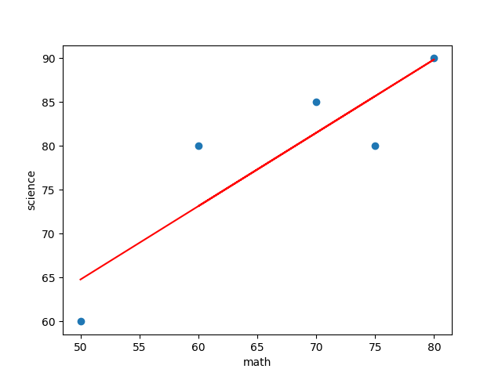

# 機械学習 - 回帰 - 線形回帰

## 線形回帰

* 線形回帰はデータ間の線形関係をモデル化する手法
* 実際の値と予測値の差（残差）の二乗和が最小になる直線を見つける（最小二乗法）
* 統計学や機械学習の分野で利用されるアルゴリズム

## キーワード

### 1変数の統計量

* 平均(Mean)

$$
\bar{x} = \frac{1}{n}\sum_{i=1}^n x_i
$$

* 分散(Variance)

$$
s^2 = \frac{1}{n}\sum_{i=1}^n (x_i - \bar{x})^2
$$

* 標準偏差(Standard Deviation)

$$
s = \sqrt{ \frac{1}{n}\sum_{i=1}^n (x_i - \bar{x})^2}
$$

### 2変数の統計量

* 共分散(Covariance)

$$
Cov(x, y) = \frac{1}{n}\sum_{i=1}^n(x_i - \bar{x})({y_i - \bar{y}})
$$

* 相関係数(Correlation, r)

$$
r = \frac{Cov(x, y)}{s_x s_y}
$$

### 回帰式

* 単回帰モデル

$$
\hat{y} = \beta_0 + \beta_1 x
$$

* 傾き

$$
\beta_1 = \frac{Cov(x, y)}{s_x^2} = \frac{\sum_{i=1}^n(x_i - \bar{x})(y_i - \bar{y})}{\sum_{i=1}^n(x_i - \bar{x})^2}
$$

* 切片

$$
\beta_0 = \bar{y} - \beta _1 \bar{x}
$$

### 学習済みモデルの評価指標

* MSE(Mean Squared Error)

$$
MSE = \frac{1}{n}\sum_{i=1}^n(\hat{y}_i - y_i)^2
$$

* MAE(Mean Absolute Error)

$$
MAE = \frac{1}{n}\sum_{i=1}^n |\hat{y}_i - y_i|
$$

* 決定係数(coefficient of determination, R2)

$$
R^2 = 1 - \frac{SS_{res}}{SS_{total}}
$$

> 単回帰では、決定係数は相関係数の2乗に等しくなります（$R^2 = r^2$）。

* 参考：全変動

$$
SS_{total} = \sum_{i=1}^n (y_i - \bar{y})^2
$$

* 参考：回帰変動

$$
SS_{reg} = \sum_{i=1}^n (\hat{y}_i - \bar{y})^2
$$

* 参考：残差変動

$$
SS_{res} = \sum_{i=1}^n (\hat{y}_i - y_i)^2
$$

> 切片ありの最小二乗法では $SS_{total} = SS_{reg} + SS_{res}$ となるため、決定係数は $R^2 = \frac{SS_{reg}}{SS_{total}}$ とも表せます。

---

## サンプルデータ

score.csv

```csv
math,science
50,60
70,85
80,90
60,80
75,80
```

---

## Python

1. CSVファイルの読み込み
2. 平均、分散、標準偏差の出力
3. 散布図の出力
4. 共分散、相関係数の出力
5. モデルの学習
6. 回帰直線の出力
7. モデルの評価

---

### 1. CSVファイルの読み込み

```python
import pandas as pd

score_df = pd.read_csv("score.csv")
score_df
```

### 2. 平均、分散、標準偏差の出力

* 平均

```python
score_df.mean()
```

* 分散

```python
score_df.var(ddof=0)
```

> pandas は初期設定で n-1 で割ります。式に合わせるため `ddof=0` を指定します。

* 標準偏差

```python
score_df.std(ddof=0)
```

### 3. 散布図の出力

```python
score_df.plot.scatter('math', 'science')
```

### 4. 共分散、相関係数の出力

* 共分散

```python
score_df.cov(ddof=0)
```

* 相関係数

```python
score_df.corr()
```

### 5. モデルの学習

* 特徴量（説明変数）

```python
x = score_df.loc[:, ['math']]
x
```

* 目的変数

```python
y = score_df.loc[:, 'science']
y
```

* 学習

```python
from sklearn.linear_model import LinearRegression

model = LinearRegression()
model.fit(x, y)
```

* 回帰式の係数（傾き）

```python
model.coef_
```

* 回帰式の切片

```python
model.intercept_
```

* 参考：式から傾きと切片を計算する

```python
beta_1 = score_df.cov(ddof=0).loc['math', 'science'] / score_df.var(ddof=0)['math']
beta_0 = score_df['science'].mean() - beta_1 * score_df['math'].mean()
beta_1, beta_0
```

> `model.coef_`、`model.intercept_` と同じ値（約 0.836、約 22.97）になります。

### 6. 回帰直線の出力

```python
import matplotlib.pyplot as plt

plt.scatter(x['math'], y)
plt.plot(x['math'], model.predict(x), color='red')
plt.xlabel('math')
plt.ylabel('science')
plt.show()
```

### 実行結果



### 7. モデルの評価

> ここでは学習に使ったデータでそのまま評価しています。本来は、学習に使っていないテストデータで評価します。

* 決定係数

```python
model.score(x, y)
```

* 予測

```python
y_pred = model.predict(x)
y_pred
```

* MAE

```python
from sklearn.metrics import mean_absolute_error

mean_absolute_error(y, y_pred)
```

* MSE

```python
from sklearn.metrics import mean_squared_error

mean_squared_error(y, y_pred)
```
